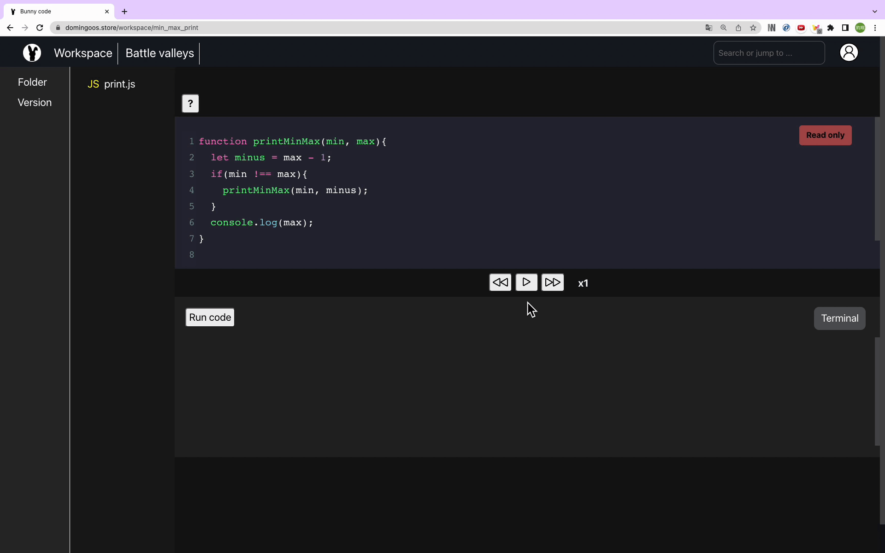
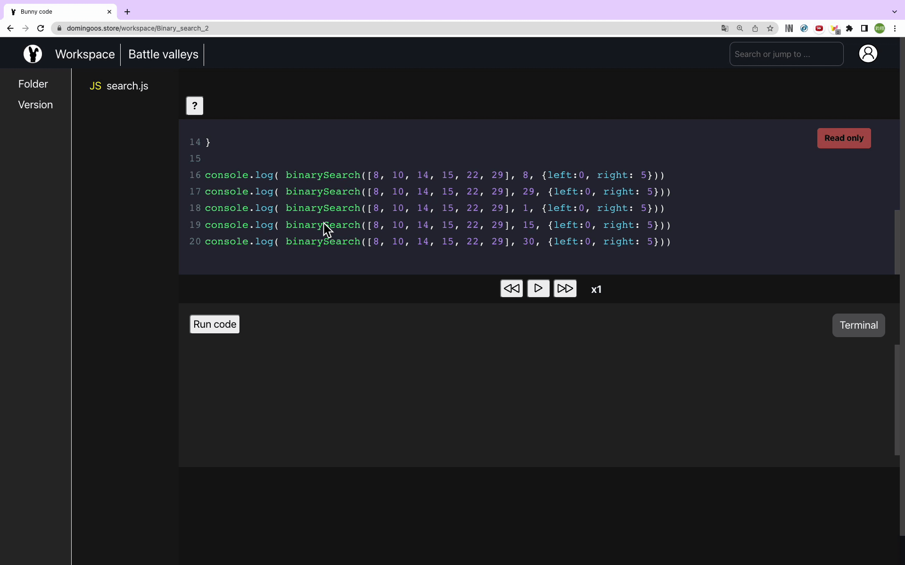
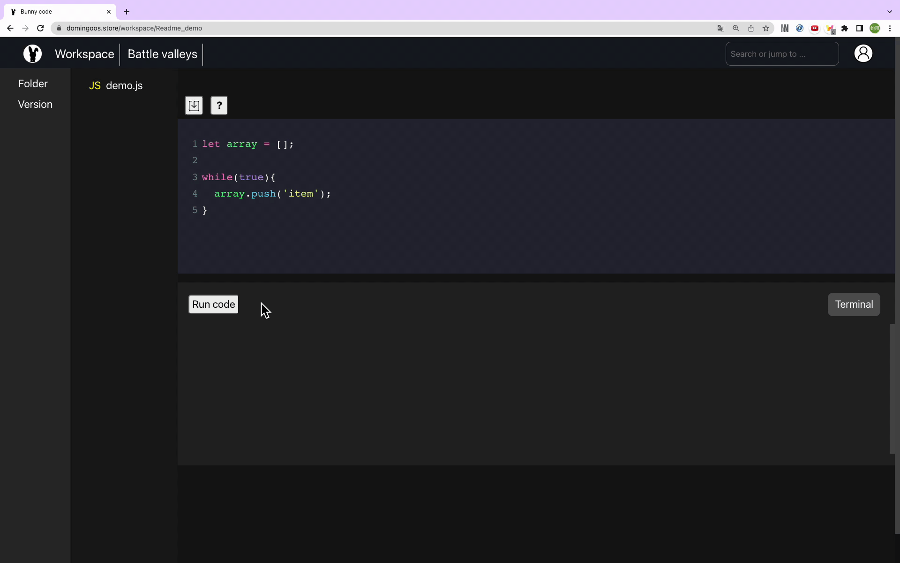
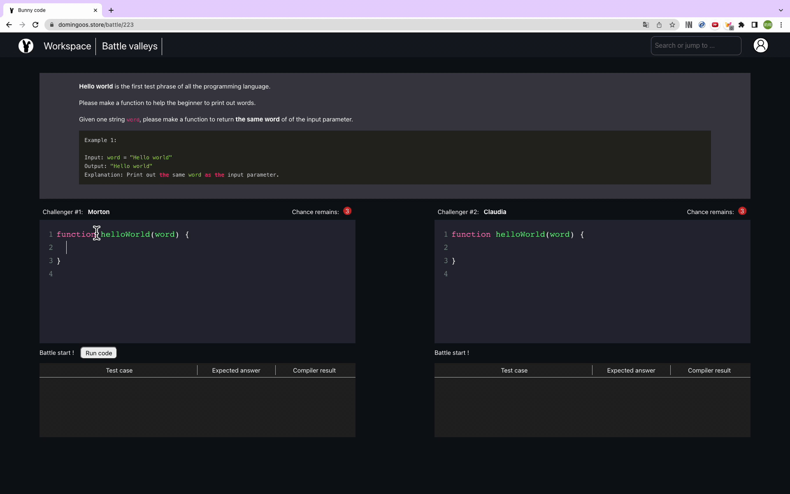
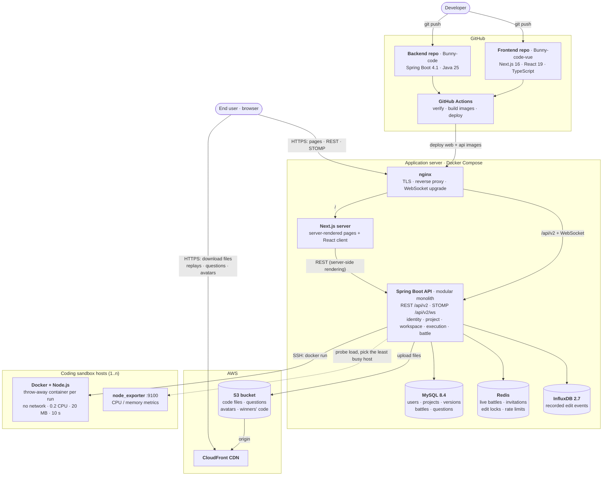

# Bunny Code

> A brand new coding website. Supports replaying coding process and launching a coding battle. For more information, please check out [Bunny Code](https://www.domingoos.store).

## Table of content

- [Background and Why Bunny Code](#background-and-why-bunny-code)
- [Links](#links)
- [Demo](#demo)
- [Features - Workspace](#features---workspace)
- [Features - Battle Valley](#features---battle-valley)
- [Tech Stack](#tech-stack)
- [Development](#development)
- [System Architecture](#system-architecture)
- [Future Features](#future-features)

## Background and Why Bunny Code

Being a software engineer, we learn continuously to enrich ourselves. However, there are no integrated resources where we could learn from other people's `coding processes` and edit our own project at the same time. Not to mention `battle with each other`.

Bunny Code was borned to cope with the problem. Bunny Code is dedicated to help users learn by replaying coding processes as if video clips and practice by launching live battles. With Bunny Code, users can `edit codes`, `run codes`, `control versions`, `replay codes`, `launch battles` whenever they want !

## Links

**Bunny Code Homepage**: [Bunny Code](https://domingoos.store)

```
// first user
Account: domingoos@gmail.com
Password: test1234

// second user (for battle)
Account: guest@gmail.com
Password: test1234
```

**Frontend Repo**: [Bunny-code-vue](https://github.com/domingo1021/Bunny-code-vue)

**Backend Repo**: [Bunny-code](https://github.com/domingo1021/Bunny-code)

## Features - Workspace

- **Record** and **replay** users' projects in workspace
- Provide **play**, **pause**, **speed up** and **slow down** to help user to replay coding processes as if watching video clips.
- **Preview coding archives** of projects at the first time users go into the workspace.
- Provide various **shortcuts** to help developers edit project much faster.
- Allow user **run codes** immediately after they edit codes or watch codes.
- **Create version** from latest coding process and provide **version control**. Help users compare differences between version by replaying projects' coding processes.

## Features - Battle Valley

- **Choose a question level**, **launch a battle**, then user can compete with others in battle valley.
- **Watch a live battle** in battle valley as long as user want.
- **Run codes** to check the answer of the appointed question.
- Compare **expected outputs** and **battler coding outputs** for test cases, help battlers to improve their codes.
- **Share winner coding archives** of battles to help users learn from each other.

## Demo

- Replay coding process ( x1 )

  

- Replay coding process ( x2 )

  

- Run code (Normal situation)

  

- Run code (Out of memory)

  

- Battle valley

  

## Tech stack

- Frontend: `Vue.js` `Bootstrap` (moving to `Next.js` + `TypeScript`, see [the plan](./docs/MIGRATION_PLAN.md))
- Backend: `Java 25` `Spring Boot 4.1` `Spring Data JPA / Hibernate 7` `Spring Security (JWT)` `STOMP over WebSocket` `Spring Modulith`
- Database: `MySQL` (Flyway migrations) `InfluxDB` `Redis`
- Sandbox: `Docker` (no network, read-only, 0.2 CPU / 20 MB / 10 s) `node-exporter`
- Cloud services: `S3` `CloudFront`
- Testing: `JUnit 5` `Mockito` `AssertJ` `ArchUnit` `Cucumber (BDD)` `Testcontainers` `JaCoCo`
- Continuous integration: `GitHub Actions`

## Development

Requirements: JDK 25 and a running Docker daemon (tests use Testcontainers).

```bash
./mvnw verify                                                    # all tests + coverage gate
docker compose -f Docker/local/compose.yaml up -d --wait         # MySQL, Redis, InfluxDB, S3 on localhost
./mvnw spring-boot:run -Dspring-boot.run.profiles=local          # API on :8080
node Docker/local/seed.mjs                                       # demo accounts and projects
```

**[docs/CICD.md](./docs/CICD.md)** describes the CI/CD pipelines of both repositories and the
production deployment. **[INSTRUCTION.md](./INSTRUCTION.md)** walks through the whole local setup — infrastructure,
API, demo data, the web app against it, and every backend and frontend test suite.

| Layer | What it covers | Where |
|---|---|---|
| Unit | domain rules, services, judge, sandbox command building (`*Test`) | `src/test/java` |
| Slice | controllers with the real security chain and validation (`*ControllerTest`) | `src/test/java` |
| Integration | JPA queries incl. N+1 statement counts, Redis Lua scripts, InfluxDB, S3, the real Docker sandbox (`*IT`) | `src/test/java` |
| BDD | end-to-end behaviour over HTTP and STOMP, in Gherkin | `src/test/resources/features` |

Reports: `target/cucumber-reports/cucumber.html`, `target/site/jacoco/index.html`,
module diagrams in `target/spring-modulith-docs`. The API contract for clients is
[`.claude/skills/backend/references/api-surface.md`](./.claude/skills/backend/references/api-surface.md);
configuration is listed in [`.env.example`](./.env.example).

## System architecture



- **One origin.** nginx terminates TLS and routes `/` to the Next.js server and `/api/v2` (REST and the
  STOMP WebSocket) to the Spring Boot API, so the browser talks to a single host.
- **Next.js** renders pages on the server, calling the API for data, then runs as a React app in the
  browser: REST for projects, recordings and battle listings, STOMP for invitations and live battles.
- **Spring Boot API** is a modular monolith (Spring Modulith): `identity`, `project`, `workspace`,
  `execution`, `battle` and `storage` modules over a `shared` module (security, errors, realtime).
  - **MySQL** holds the relational data (via JPA and Flyway); **Redis** holds short-lived shared state —
    live battle code and chances, invitations, edit locks, rate limits; **InfluxDB** stores the recorded
    edit events that replays are rebuilt from.
  - **S3** stores files (each version's code, recording base files, questions, avatars, winners' code);
    browsers download them through **CloudFront**.
  - **Code execution** — workspace runs and battle submissions — goes over SSH to the least-loaded
    sandbox host (chosen from its `node_exporter` metrics) and runs in a throw-away Docker container
    with no network and hard CPU, memory and time limits.
- **GitHub Actions** verifies both repositories and builds and deploys the `web` and `api` images.

This is the target production layout. The Next.js container, the single-origin nginx routing and the
image-based deploy are still being set up — see [`docs/REMAINING_TASKS.md`](./docs/REMAINING_TASKS.md)
(T2, T3).

## Future Features

- More `shortcuts` in workspace. For example: `redo`, `undo`, and etc.
- `Friend` and `follower` mechanism. Help users invite battles to a target person.
